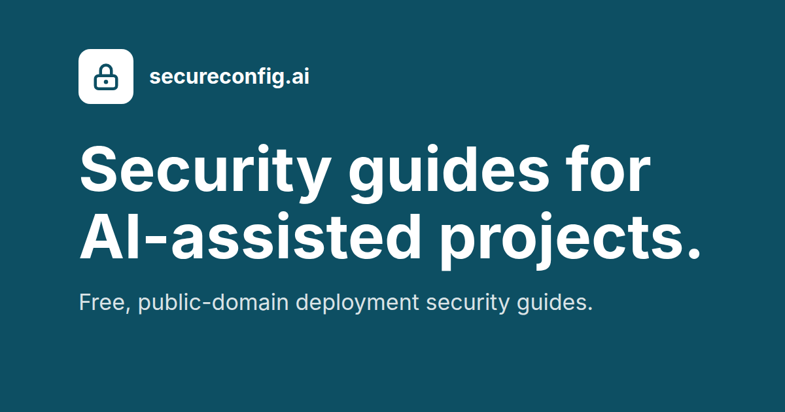
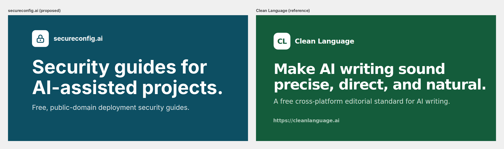
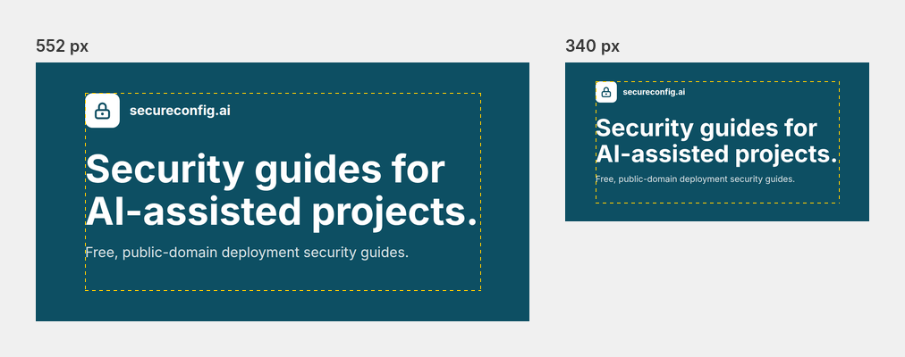
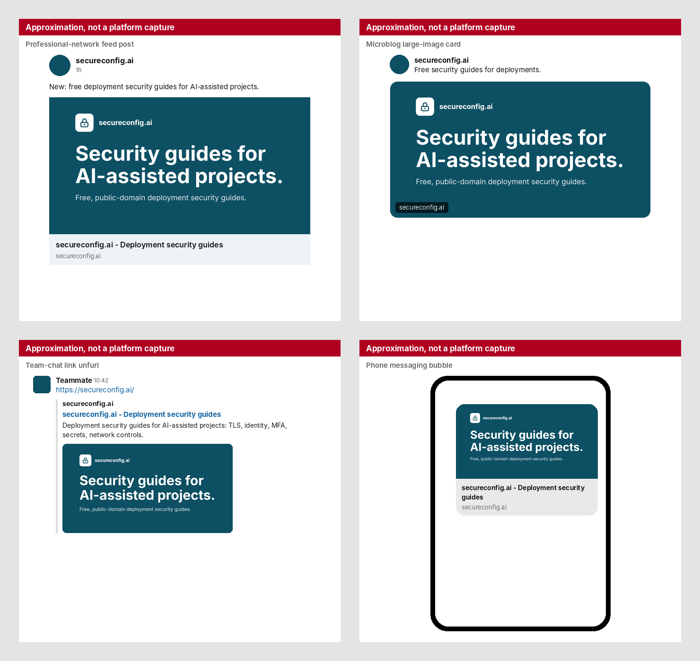

# secureconfig.ai link-preview card: review

Review files only. This folder lives on the `card-review` branch, outside `site/`, and is never deployed or merged.

## Card

The proposed card at full size, 1200 x 630 PNG, 51,434 bytes.

## Family look

The proposed card beside the Clean Language card, both at 1200 x 630.

## Small sizes

The card at 552 px and 340 px wide; the dashed rectangle marks the 960 x 480 safe area (review only, not part of the card).

## Platform previews

Approximate previews in a professional-network feed post, a microblog large-image card, a team-chat unfurl and a phone messaging bubble. They are approximations, not platform captures; the post text, sender name and time in them are placeholders.

## Proposed text

| Item | Text |
|---|---|
| Headline | Security guides for AI-assisted projects. |
| Subline | Free, public-domain deployment security guides. |
| URL line | Omitted |
| og:title and twitter:title | secureconfig.ai - Deployment security guides |
| og:description and twitter:description | Deployment security guides for AI-assisted projects: TLS, identity, MFA, secrets, network controls. |
| og:image:alt and twitter:image:alt | secureconfig.ai: Free, public-domain deployment security guides. |

## Build notes

- Background #0d4f63, the site's favicon tile colour and its hero gradient midpoint; the logo tile is the site's own padlock mark in white.
- Font: Inter Bold and Regular, the closest installed substitute for the site's system-ui stack (system-ui resolves to DejaVu Sans on the render host).
- Headline 94 px, sized by the page script as the largest size at which its wider line fits 960 px (956.98 px; 95 px would be 967.16 px). Subline 34 px, name 32 px.
- Clear space measured from the PNG's pixels: left 120, right 130, top 75, bottom 148 (minimums 120, 120, 75, 75).
- Subline colour #dde6e9 as specified (contrast 7.16:1 on #0d4f63); Chrome renders it as #d9e3e6 (6.94:1). White text is 9.07:1.
- Source: [card.html](card.html), rendered with headless Chrome 156 at exactly 1200 x 630.
